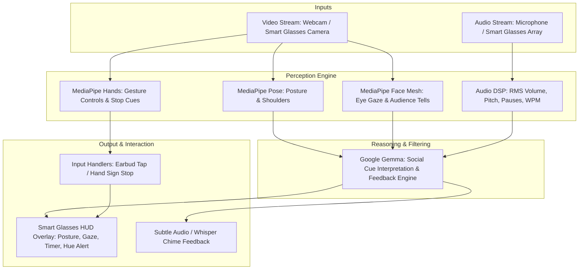
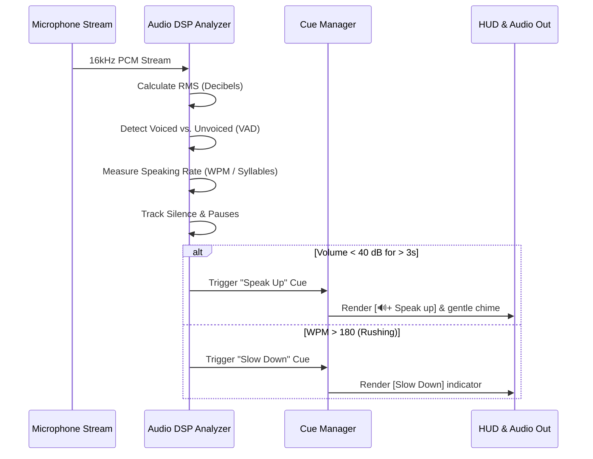

# Wingman: Meta Glasses Presentation & Social Cue Assistant
## Comprehensive Implementation Plan & Architecture Specification

> **Hacktoberfest / Hackathon Project**  
> **Tech Stack:** Python 3.12, `uv`, MediaPipe, Google Gemma, OpenCV / Pygame / Web UI, Pytest, Black  
> **Target Device:** Meta Ray-Ban / Smart Glasses (Simulated HUD & Audio Feedback System)

---

## Executive Summary

Many speakers struggle with real-time presentation delivery, reading audience reactions, and pacing their talks. **Wingman** acts as an AI-powered smart glasses companion that provides unobtrusive, real-time visual and auditory cues directly in the speaker's field of view (HUD).

Using **MediaPipe** for high-framerate on-device vision processing (posture, eye contact, audience confusion, hand gestures) and **Google Gemma** for contextual reasoning and cue filtering, the system continuously analyzes audio-visual feeds and renders minimal, distraction-free HUD indicators (e.g., posture alignment arrows, eye contact targets, volume chimes, and a videogame-style border vignette as presentation time runs out).



---

## Table of Contents
1. [Core Feature Breakdown](#1-core-feature-breakdown)
2. [System Architecture & Module Layout](#2-system-architecture--module-layout)
3. [Component Specifications](#3-component-specifications)
   - 3.1 [Vision Pipeline (MediaPipe)](#31-vision-pipeline-mediapipe)
   - 3.2 [Acoustic & Speech Analysis Pipeline](#32-acoustic--speech-analysis-pipeline)
   - 3.3 [Intelligence & Cue Filtering Engine (Google Gemma)](#33-intelligence--cue-filtering-engine-google-gemma)
   - 3.4 [Smart Glasses HUD & Visual Feedback Engine](#34-smart-glasses-hud--visual-feedback-engine)
   - 3.5 [Gesture & Earbud Control System](#35-gesture--earbud-control-system)
4. [Step-by-Step Implementation Roadmap](#4-step-by-step-implementation-roadmap)
   - [Phase 1: Environment & Architecture Skeleton](#phase-1-environment--architecture-skeleton)
   - [Phase 2: Real-time Audio & Video Ingestion](#phase-2-real-time-audio--video-ingestion)
   - [Phase 3: MediaPipe Vision Features](#phase-3-mediapipe-vision-features)
   - [Phase 4: Audio Speech & Pace Metrics](#phase-4-audio-speech--pace-metrics)
   - [Phase 5: Google Gemma LLM Integration](#phase-5-google-gemma-llm-integration)
   - [Phase 6: Customizable HUD & Dynamic Vignette](#phase-6-customizable-hud--dynamic-vignette)
   - [Phase 7: Gesture Controls & Earbud Interactivity](#phase-7-gesture-controls--earbud-interactivity)
   - [Phase 8: End-to-End Testing & Hackathon Demo Polish](#phase-8-end-to-end-testing--hackathon-demo-polish)
5. [User Interface & HUD Design Themes](#5-user-interface--hud-design-themes)
6. [Testing, CI/CD, and Verification Strategy](#6-testing-cicd-and-verification-strategy)

---

## 1. Core Feature Breakdown

| Feature | Input Source | Processing Engine | HUD / Audio Output |
| :--- | :--- | :--- | :--- |
| **Posture Correction** | Video (Speaker Camera / Pose) | MediaPipe Pose Landmarker | Directional arrow (↑ Straighten Posture, shoulder leveling guides) |
| **Gaze & Eye Contact** | Video (Front Camera / Gaze) | MediaPipe Face Mesh & Iris | Circle target (◎ Make eye contact), Arrow (→ Scan room / look right) |
| **Audience Social Tells** | Video (Audience Facing) | MediaPipe Face Mesh + Gemma | Confusion detection (scrunched brow), surprise/interest (wide eyes) |
| **Volume Feedback** | Audio (Mic) | Audio DSP (RMS / Decibel Meter) | Speaker icon (`🔊+` Speak up / `🔉` Tone down), subtle tone chime |
| **Pacing & Talking Speed** | Audio (Mic) | STT / Audio DSP (Words Per Min) | WPM indicator, pause reminders when rushing |
| **Presentation Timer & Edge Hue** | System Clock / User Target | Time Tracking Engine | Live `MM:SS` timer + yellow-to-red progressive border vignette |
| **Gesture Stopping & Control** | Video (Hands) & Audio (Tap) | MediaPipe Hands / Audio Peak | Open palm / stop sign or earbud double-tap to dismiss cue |
| **Custom HUD Themes** | User Config | Rendering Canvas | Ironman Jarvis HUD, Minimalist Glass, High Contrast Dark/Light |

---

## 2. System Architecture & Module Layout

The codebase will follow a modular architecture under `src/` to separate streaming inputs, ML inference, heuristic calculations, and presentation rendering.

```
c:\Users\alexa\Hackathon_1025\
├── .github/
│   └── workflows/
│       └── ci.yml               # GitHub Actions: Black + Pytest PR enforcement
├── config/
│   ├── default_config.yaml      # Default thresholds, timer limits, theme selection
│   └── themes.yaml              # HUD styling (Ironman, Minimalist, Cyberpunk)
├── src/
│   ├── __init__.py
│   ├── main.py                  # Application entry point & orchestration loop
│   ├── capture/                 # Video & Audio ingestion
│   │   ├── __init__.py
│   │   ├── video_stream.py      # Camera capture / virtual glasses video feed
│   │   └── audio_stream.py      # Microphone buffer & continuous audio sampler
│   ├── vision/                  # MediaPipe processing pipelines
│   │   ├── __init__.py
│   │   ├── pose_tracker.py      # Posture, slumping, and spine angle calculation
│   │   ├── gaze_tracker.py      # Eye contact, iris tracking, room coverage
│   │   ├── audience_tells.py    # Facial expression blendshapes (confusion, surprise)
│   │   └── gesture_detector.py  # Hand signs (stop, hold, swipe navigation)
│   ├── audio/                   # Audio metrics & speech analysis
│   │   ├── __init__.py
│   │   ├── volume_analyzer.py   # RMS, decibel calculations, whisper detection
│   │   ├── pace_analyzer.py     # Syllables/words per minute & pause detection
│   │   └── audio_feedback.py    # Chime generation & subtle audio alerts
│   ├── intelligence/            # Gemma LLM & cue filtering
│   │   ├── __init__.py
│   │   ├── gemma_client.py      # Google Gemma API / local lightweight model
│   │   └── cue_filter.py        # Distillation of noise vs. critical coaching tips
│   └── hud/                     # Visual display & HUD rendering
│       ├── __init__.py
│       ├── renderer.py          # Pygame / OpenCV transparent overlay renderer
│       ├── widgets.py           # HUD widgets (Posture arrow, Eye circle, Timer)
│       └── vignette.py          # Dynamic yellow/red glowing border edge effect
├── tests/
│   ├── test_main.py
│   ├── test_vision.py           # Pose, gaze, and gesture unit tests
│   ├── test_audio.py            # Volume and pace calculation unit tests
│   └── test_hud.py              # Widget rendering and state unit tests
├── pyproject.toml               # Project dependencies and tool configurations
├── uv.lock                      # uv locked dependencies
└── README.md                    # Project documentation & demo guide
```

---

## 3. Component Specifications

### 3.1 Vision Pipeline (MediaPipe)

The vision subsystem utilizes **MediaPipe Solutions** for real-time edge processing:

1. **Pose & Posture Tracking (`pose_tracker.py`)**:
   - Landmarks used: Left/Right Shoulders (11, 12), Left/Right Ears (7, 8), Nose (0), Hips (23, 24).
   - Metrics:
     - Shoulder tilt angle: $\theta_{\text{shoulder}} = \arctan\left(\frac{y_{12} - y_{11}}{x_{12} - x_{11}}\right)$.
     - Head forward slump: Vertical and horizontal distance between ear and shoulder projection.
   - Triggers: If slouch exceeds $12^\circ$ or ear forward-offset $> 15\%$, display the `↑ Straighten Posture` cue.

2. **Gaze & Eye Contact (`gaze_tracker.py`)**:
   - Landmarks used: MediaPipe Face Mesh with refined Iris landmarks (468–477).
   - Metrics: Gaze vector relative to camera center; duration spent looking down (notes) or off to one side.
   - Triggers:
     - Prolonged fixation away from audience ($> 4$ seconds) -> `◎ Make eye contact` target.
     - Narrow focus on only one side of the room -> `→ Look around room / look rightwards`.

3. **Audience Social Tells (`audience_tells.py`)**:
   - Detects audience engagement patterns:
     - **Brow furrowing / Forehead scrunching** (corrugator supercilii contraction, distance between brow landmarks `<` threshold): Suggests audience confusion or need for clarification.
     - **Wide eyes / raised brows** (increased eye aspect ratio and brow-to-eye height): Indicates surprise or strong engagement.
   - Feeds extracted blendshapes to the Gemma intelligence module.

4. **Hand Gesture Controls (`gesture_detector.py`)**:
   - MediaPipe Hands tracks 21 hand landmarks.
   - Recognized gestures:
     - **Open Palm / Raised Hand**: Temporarily pause or snooze active visual cues.
     - **Horizontal Swipe**: Cycle through HUD widgets or toggle between Ironman and Minimalist modes.
     - **Pinch / Hold**: Adjust sensitivity thresholds on the fly.

---

### 3.2 Acoustic & Speech Analysis Pipeline

The audio subsystem operates on a sliding $2.5$-second circular audio buffer:



- **Volume Analyzer (`volume_analyzer.py`)**:
  - RMS Decibel calculation: $\text{dB} = 20 \log_{10}\left(\frac{\text{RMS}}{\text{Ref}}\right)$.
  - Triggers: Volume below comfortable room acoustics ($< 42 \text{ dB}$) triggers the `🔊+ Speak up` widget.
- **Pacing & Pause Analyzer (`pace_analyzer.py`)**:
  - Computes Words Per Minute (target: 130–160 WPM).
  - Flags rapid speech without natural cadence or run-on sentences without pauses ($> 8\text{s}$ continuous speech).

---

### 3.3 Intelligence & Cue Filtering Engine (Google Gemma)

To prevent visual clutter on the smart glasses HUD, **Google Gemma** functions as a real-time contextual arbiter:

1. **Noise vs. Tell Filtering**:
   - A single quick glance away is natural; Gemma filters out transient movements and only flags persistent maladaptive habits.
   - Correlates audience facial cues (e.g., scrunched brow) with speech segments to recommend: *"Audiences appear confused; consider reiterating your last point."*
2. **Coaching Tone Generator**:
   - Formulates concise, friendly micro-prompts (e.g., *"Take a breath, great pace,"* *"Project to the back row"*).
   - Formats outputs into structured JSON consumable by the HUD widget engine:
   ```json
   {
     "priority": "HIGH",
     "cue_type": "POSTURE",
     "display_text": "Straighten Posture",
     "icon": "arrow_up",
     "duration_ms": 3000,
     "audio_chime": true
   }
   ```

---

### 3.4 Smart Glasses HUD & Visual Feedback Engine

1. **Widget Architecture (`widgets.py`)**:
   - Modular HUD overlay rendered using high-contrast, semi-transparent layers.
   - Specific widgets:
     - **Arrow Widget**: Points in the direction of correction (Straighten Up, Look Rightwards).
     - **Target Circle**: Appears in the center or perimeter to draw user's eye to natural eye contact level.
     - **Volume Bar & Speaker**: Shows active mic level and alerts when speech drops below threshold.
     - **Timer Display**: Shows remaining presentation time in format `MM:SS`.

2. **Dynamic Edge Vignette (`vignette.py`)**:
   - Creates a videogame-inspired screen border glow as presentation time elapses:
     - **Normal (Time $> 25\%$)**: Transparent / subtle neutral indicator.
     - **Warning (Time between $10\%$ and $25\%$)**: Soft pulsing **amber/yellow hue** around the perimeter.
     - **Critical (Time $< 10\%$)**: Intense glowing **red hue** fading inwards, providing urgency without obstructing the speaker's view.

```
+-------------------------------------------------------------+
| [! YELLOW/RED EDGE GLOW PULSES AS TIMER RUNS LOW !]         |
|  [08:45]                                                    |
|                                         [🔊+ Speak Up]      |
|                                                             |
|                     ↑ Straighten                            |
|                                                             |
|            ( ◎ Look Here )                                  |
|                                             [→ Scan Room]   |
+-------------------------------------------------------------+
```

---

### 3.5 Gesture & Earbud Control System

- **Earbud Tap Simulation**:
  - Double-tap detection via mic acoustic signature or dedicated keybinding (`Space` / `Enter`).
  - Instantly acknowledges and dismisses the currently active cue.
- **Hand Signs**:
  - Raising an open palm toward the glasses camera pauses feedback for 30 seconds (e.g., during Q&A or audience question).

---

## 4. Step-by-Step Implementation Roadmap

```mermaid
gantt
    title Wingman Hackathon Implementation Roadmap
    dateFormat  X
    axisFormat  Day %d
    section Phase 1: Foundation
    Setup & Environment Specs       :p1, 0, 1
    section Phase 2: Ingestion
    Video & Audio Capture Buffers   :p2, 1, 2
    section Phase 3: Vision
    MediaPipe Pose, Gaze, Gestures  :p3, 2, 4
    section Phase 4: Audio
    Volume, Pace & Tone DSP         :p4, 3, 5
    section Phase 5: Intelligence
    Gemma Social Cue Reasoning      :p5, 4, 6
    section Phase 6: HUD & UI
    Widgets, Themes & Edge Vignette :p6, 5, 7
    section Phase 7: Controls
    Earbud Tap & Hand Gestures      :p7, 6, 8
    section Phase 8: Polish & Demo
    E2E Integration & Demo Polish   :p8, 7, 9
```



---

### Phase 1: Environment & Architecture Skeleton
- [ ] **Task 1.1**: Define and install all runtime dependencies via `uv`:
  ```bash
  uv add mediapipe opencv-python numpy pygame pyyaml sounddevice scipy google-genai
  uv add --dev black pytest pytest-cov
  ```
- [ ] **Task 1.2**: Establish project directory structure under `src/` and `tests/`.
- [ ] **Task 1.3**: Create configuration schema in `config/default_config.yaml` (timer lengths, alert sensitivities, thresholds).
- [ ] **Acceptance Criteria**: `uv run pytest` runs cleanly; configuration loads without errors.

---

### Phase 2: Real-time Audio & Video Ingestion
- [ ] **Task 2.1**: Implement `src/capture/video_stream.py` supporting webcam capture and pre-recorded video playback for headless testing.
- [ ] **Task 2.2**: Implement `src/capture/audio_stream.py` utilizing `sounddevice` with a thread-safe ring buffer.
- [ ] **Task 2.3**: Write unit tests for frame dropping, synchronization, and buffer overflow protection.
- [ ] **Acceptance Criteria**: Sustained 30 FPS video capture and non-blocking 16kHz audio sampling with $< 20\text{ms}$ latency.

---

### Phase 3: MediaPipe Vision Features
- [ ] **Task 3.1**: Implement `src/vision/pose_tracker.py` using MediaPipe Pose Landmarker to calculate shoulder leveling and slump angles.
- [ ] **Task 3.2**: Implement `src/vision/gaze_tracker.py` with MediaPipe Face Mesh to monitor eye contact and horizontal room distribution.
- [ ] **Task 3.3**: Implement `src/vision/audience_tells.py` to extract facial blendshapes (brow furrowing, surprised eyes).
- [ ] **Task 3.4**: Implement `src/vision/gesture_detector.py` for palm stop and swipe navigation.
- [ ] **Acceptance Criteria**: Pose and gaze algorithms produce normalized vectors tested against sample frames in `tests/test_vision.py`.

---

### Phase 4: Audio Speech & Pace Metrics
- [ ] **Task 4.1**: Implement `src/audio/volume_analyzer.py` for real-time RMS decibel computation and quiet speech detection.
- [ ] **Task 4.2**: Implement `src/audio/pace_analyzer.py` for voice activity detection (VAD), silence pause counting, and cadence estimation.
- [ ] **Task 4.3**: Implement `src/audio/audio_feedback.py` using synthesized sine wave audio chimes for gentle alerts.
- [ ] **Acceptance Criteria**: Volume analyzer accurately detects drops below $40\text{ dB}$ within $500\text{ms}$; unit tests pass in `tests/test_audio.py`.

---

### Phase 5: Google Gemma LLM Integration
- [ ] **Task 5.1**: Implement `src/intelligence/gemma_client.py` communicating with Google Gemma (via Google GenAI API or local ONNX/Gemma-2B).
- [ ] **Task 5.2**: Design zero-shot prompt engineering for real-time social cue arbitration:
  - Input: Current posture score, gaze duration, volume dB, audience blendshapes.
  - Output: Structured JSON action cue.
- [ ] **Task 5.3**: Build `src/intelligence/cue_filter.py` with cooldown heuristics (minimum 5 seconds between repeated alerts).
- [ ] **Acceptance Criteria**: Cue filter generates actionable, non-redundant tips without lagging the vision loop.

---

### Phase 6: Customizable HUD & Dynamic Vignette
- [ ] **Task 6.1**: Implement HUD rendering engine in `src/hud/renderer.py` supporting transparent canvas overlays.
- [ ] **Task 6.2**: Build reusable HUD widgets in `src/hud/widgets.py`:
  - `↑ Straighten Posture` directional arrow
  - `◎ Make eye contact` target reticle
  - `→ Look right / scan room` arrow
  - `🔊+ Speak up` volume badge
  - `MM:SS` timer widget
- [ ] **Task 6.3**: Implement `src/hud/vignette.py` rendering radial color gradients (amber yellow at $25\%$ time left, glowing red at $10\%$).
- [ ] **Task 6.4**: Support switchable themes in `config/themes.yaml`:
  - **Ironman Mode**: Cyan/orange holographic widgets with HUD telemetry brackets.
  - **Minimalist Mode**: Clean monochrome icons and thin modern typography.
- [ ] **Acceptance Criteria**: HUD overlays smoothly on video frames at $\ge 30\text{ FPS}$ with controllable opacity.

---

### Phase 7: Gesture Controls & Earbud Interactivity
- [ ] **Task 7.1**: Connect hand gesture triggers (e.g., open palm) to dismiss or snooze current alerts.
- [ ] **Task 7.2**: Implement earbud tap simulation via keyboard hotkeys (`Space` / `T`) and audio spike detection.
- [ ] **Task 7.3**: Enable gesture-based theme toggling and sensitivity calibration.
- [ ] **Acceptance Criteria**: Tapping or gesturing immediately clears active HUD warnings and enters cooldown state.

---

### Phase 8: End-to-End Testing & Hackathon Demo Polish
- [ ] **Task 8.1**: Create `main.py` uniting capture, vision, audio, intelligence, and HUD rendering into a seamless pipeline.
- [ ] **Task 8.2**: Add demo mode with mock data / sample video inputs for reliable live presentations.
- [ ] **Task 8.3**: Document usage, setup, and hotkeys in `README.md`.
- [ ] **Task 8.4**: Validate complete test suite (`uv run pytest`) and code formatting (`uv run black --check .`).
- [ ] **Acceptance Criteria**: Full end-to-end demonstration running stably for a 5-minute presentation demo.

---

## 5. User Interface & HUD Design Themes

### Theme 1: Ironman Jarvis HUD (Futuristic)
- **Palette**: Neon Cyan (`#00F0FF`), Warning Amber (`#FFB800`), Alert Crimson (`#FF003C`).
- **Typography**: Monospace / Technical HUD styling.
- **Accents**: Circular reticles, corner brackets around widgets, soundwave bar for microphone feedback.

### Theme 2: Minimalist Meta Glass (Distraction-Free)
- **Palette**: Frosted White (`rgba(255, 255, 255, 0.85)`), Warning Orange (`#FFA500`), Danger Red (`#FF3B30`).
- **Typography**: Clean Sans-Serif (Inter / Roboto style).
- **Accents**: Subtle floating glyphs that gently fade in and out after 3 seconds.

---

## 6. Testing, CI/CD, and Verification Strategy

1. **Automated Testing Suite**:
   - `test_vision.py`: Tests mathematical calculations of angles and gaze vectors using synthetic landmark arrays.
   - `test_audio.py`: Validates RMS math and threshold trigger logic against mock PCM byte streams.
   - `test_hud.py`: Verifies widget positioning, layout bounds, and vignette alpha decay over time.
2. **Quality Gates & GitHub Actions**:
   - Every Pull Request automatically triggers [.github/workflows/ci.yml](file:///c:/Users/alexa/Hackathon_1025/.github/workflows/ci.yml) running:
     - `uv run black --check .` (Formatting conformance)
     - `uv run pytest` (100% passing test assertions)
3. **Hardware-Free Local Testing**:
   - Synthetic dummy video and audio generators allow team members to develop and verify all features without requiring physical smart glasses or webcams attached.
